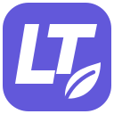

# LifeTools

Yerel çalışan Chrome eklentisi ve masaüstü verimlilik araçları.

## Neyin ne olduğu

| Klasör | İçerik |
| --- | --- |
| `src/` | Chrome Manifest V3 eklentisi kaynak kodu |
| `dist/` | Derlenmiş, Chrome'a yüklenen eklenti |
| `desktop/` | Windows için Tauri 2 masaüstü uygulaması |
| `design/` | Ortak tasarım değişkenleri, bileşenler ve ikonlar |
| `tests/` | Eklenti testleri |

## Özellikler

Eklenti simgesi hızlı işlemleri, **Panel** ise araçları ve ayarlarını açar. İlk kurulumda açılan özellik rehberinden kullanacağın özellikleri seçersin; kapattıkların menülerden ve Panel'den gizlenir. Ek site izni isteyen özellikler izin verildiğinde çalışır; otomatik sekme uyutma ve pencere kapanınca otomatik kaydetme başlangıçta kapalıdır. Kısayolları `chrome://extensions/shortcuts` üzerinden değiştirebilirsin.

### Kısaca nasıl kullanılır

<!-- design/demos/*.svg: `node scripts/readme-demos.mjs` ile src/onboarding/demos.ts'den üretilir. -->
<table>
<tr>
<td width="50%"><br><b>SlapMemo:</b> metni seç, baloncukta <b>📝 Not</b>'a bas.</td>
<td width="50%"><br><b>Link Temizleyici:</b> bağlantıyı seç, <b>🔗 Temiz link</b>; takip ekleri silinip kopyalanır.</td>
</tr>
<tr>
<td><br><b>Sekme Yöneticisi:</b> sekmeleri gruba al, <b>Kaydet ve kapat</b> ile kayıtlı gruplara taşı.</td>
<td><br><b>Sekme Yöneticisi:</b> pencerenin tamamını kayıtlı gruba al.</td>
</tr>
<tr>
<td><br><b>Süre takibi:</b> sitelerde ne kadar kaldığını say; limitin %80'inde uyarır.</td>
<td><br><b>Ses yükseltici:</b> sekmenin sesini %600'e kadar aç.</td>
</tr>
<tr>
<td><br><b>Resim içinde resim:</b> videonun köşesindeki ⧉ ile küçük pencerede izle.</td>
<td><br><b>YouTube indirici:</b> videonun altındaki <b>↓ İndir</b>'den kalite seç <i>(masaüstü uygulaması gerekir)</i>.</td>
</tr>
<tr>
<td><br><b>X video indirici:</b> gönderinin altındaki simgeyle tek tıkla indir.</td>
<td><br><b>Instagram:</b> videoyu hızlandır, ↓ ile indir.</td>
</tr>
<tr>
<td><br><b>Döviz:</b> Steam fiyatları TL olarak görünür.</td>
<td><br><b>Sekme Yöneticisi:</b> sekmeyi tutup istediğin gruba ya da kayıtlı gruba sürükle.</td>
</tr>
</table>

**Masaüstü uygulaması**

<table>
<tr>
<td width="50%"><br><b>Hızlı not:</b> her programda <code>Ctrl+Alt+N</code>, yaz, <code>Ctrl+Enter</code>.</td>
<td width="50%"><br><b>Pano geçmişi:</b> <code>Ctrl+Alt+V</code> ile eskiden kopyaladığını seç ve yapıştır.</td>
</tr>
<tr>
<td><br><b>Metin şablonları:</b> <code>Ctrl+Shift+Space</code> ile şablonu seç, yazıya eklensin.</td>
<td><br><b>İzleme listesi:</b> film ve dizileri ekle, durumunu değiştir.</td>
</tr>
<tr>
<td><br><b>Ortam sesi:</b> yağmur, fan gibi sesleri karıştırıp çal.</td>
<td><br><b>Piller:</b> kablosuz fare, kulaklık ve kumandaların pili; azalınca bildirim.</td>
</tr>
</table>

### Chrome eklentisi

**Notlar**
- **SlapMemo:** Metni seç, altında çıkan baloncukta **📝 Not**'a bas; ya da sağ tık › "Not olarak kaydet" veya `Alt+S`. Not, sayfanın bağlantısıyla kaydedilir; Panel › Notlar'da ara ve düzenle.

**Metin**
- **Metin Kısayolları:** "/merhaba" gibi kısaltmalara metin kaydet; seçtiğin sitelerde yazıp Boşluk'a basınca açılır, ya da metin kutusuna sağ tıklayıp ekle.
- **Pano Yuvaları:** Sık yapıştırdığın beş metni (IBAN, adres, imza…) yuvalara kaydet; metin kutusunda sağ tık › "Yuvadan yapıştır".
- **Link Temizleyici:** `?utm_source=…` gibi takip eklerini silip temiz bağlantıyı kopyala; seçim baloncuğundaki **🔗 Temiz link**, sağ tık veya Panel. Otomatik temizlik ve kısa bağlantı çözümleme site izni ister.

**Sekmeler**
- **Sekme Yöneticisi:** Açık sekmeleri seçip gruplara al; istersen tüm pencereyi tek seferde kayıtlı grup yap veya kapanınca otomatik kaydet. Siteye göre gruplama, kopya kapatma ve kayıtlı grupları açma/düzenleme aynı yerde.
- **Zombi Sekme Temizleyici:** Günlerdir açmadığın sekmeleri bul; kapat ya da kayıtlı gruba taşı. İsteğe bağlı otomatik uyutma ve haftalık hatırlatma var.
- **Sekme Etiketleri** ve **Sekme Notları:** Sekmeye "Önemli" gibi bir etiket ya da "fiyatı düşerse al" gibi kısa bir not iliştir; sayfayı tekrar açınca not hatırlatılır.
- **Sekme Başlığı Temizleyici:** Başlıklardaki "(3)" sayaçlarını ve " - YouTube" gibi ekleri gizler; siteye özel kuralları Panel'de düzenle.
- **Site Araç Çubuğu:** Seçtiğin sitelerde kenarda küçük, sürüklenebilir bir çubuk çıkar; içine "temiz link kopyala", "not al" gibi eylemleri koy.

**Odak**
- **Site Engelleyici:** Dikkatini dağıtan X profillerini ekle; girince engel sayfası açılır. Korumayı Panel'den duraklat.
- **Web Süre Takibi:** Hangi sitede ne kadar kaldığını sayar; açılır penceredeki **Bugün** kartında ve Panel'de gör. Günlük limit koyarsan %80'de ve dolunca uyarır.

**Medya**
- **Video İndirici:** YouTube'da videonun altındaki **↓ İndir** ile video ya da MP3 indir; oynatma listelerini de indirir. Masaüstü uygulaması gerekir.
- **İzleme Listesi:** Film, dizi ve videoları İzlenecek / İzleniyor / Bitti diye takip et; sayfadaki "+ İzle" düğmesinden, sağ tıktan veya Panel › Medya'dan ekle.
- **X Video İndirici:** Gönderinin altındaki simgeyle tek tıkla en yüksek kalitede indir; ▾ düğmesinden kalite, GIF ve toplu indirme.
- **Instagram:** Videonun köşesindeki ↓ ile indir, hız düğmesiyle hızlandır; ilerleme çubuğuna tıkla veya sürükle.
- **Resim içinde resim:** Videonun üstüne gelince çıkan ⧉ düğmesi ya da `Alt+P` ile videoyu küçük pencerede izle.
- **Ses Yükseltici:** Açılır penceredeki "Bu sekmenin sesi" kartıyla sekmenin sesini %600'e kadar aç.
- **Döviz Çevirici:** Steam'de fiyatları TL olarak gösterir; izin verirsen her sitede fiyatın üstüne gelince TL karşılığını gösterir.

**Genel**
- **Kısayollar:** Komutları ve tuş atamalarını gör; tuşları Chrome'un kısayol sayfasında değiştir.
- **Özellik rehberi:** Her özelliğin örneği, yeri ve kısayolu tek sayfada; açılır penceredeki "Özellikler ve yenilikler"den ya da Panel › Ayarlar'dan aç. Güncellemeden sonra neyin değiştiğini de gösterir.

Seçim baloncuğu notun yanında arama, çeviri, temiz link ve pano yuvası düğmelerini de sunar. Panel'deki **Yedek** ile verileri dışa aktarabilir veya geri yükleyebilirsin; otomatik yedek ayarı da bulunur.

### Masaüstü

- **Ana sayfa:** Özet kartları ve hızlı erişimler.
- **Notlar** ve **İzleme listesi:** Eklentiyle bağlıysan aynı notlar ve liste burada da görünür. `Ctrl+Alt+N` her programda hızlı not penceresi açar.
- **Metin ve Pano:** Metin şablonu oluşturup `Ctrl+Shift+Space` ile yapıştır; pano geçmişini ara, sabitle, sil veya `Ctrl+Alt+V` seçicisinden geri kopyala.
- **Piller:** Windows'un bildirdiği sistem ve Bluetooth pil düzeyleri.
- **Ortam sesi:** Ses kanallarını, seviyeleri ve zamanlayıcıyı seç; ön ayarları kaydet veya tepsiden oynatmayı kontrol et.
- **Ayarlar:** Başlangıç, pano saklama ve gizlilik seçenekleri, tema, yedek ve Chrome bağlantısı.
- **Otomatik güncelleme:** Uygulama yeni sürümü kendisi indirip kurar; eklentiyi masaüstünün eklenti klasöründen yüklediysen eklenti de güncellenir.

## Gizlilik

Veriler yerel olarak tutulur: eklenti SQLite'ı tarayıcının OPFS alanını, masaüstü uygulaması yerel SQLite dosyasını kullanır. İsteğe bağlı bağlantıyla eklenti verileri masaüstü veritabanına taşınabilir. Telemetri yoktur; çeviri, kısa bağlantı çözümleme ve seçilen medya indirmeleri gibi ağ gerektiren işlemler ilgili servislere erişir. Pano geçmişi yerel veritabanında şifrelenmeden saklanır.

## Kurulum

### Hazır sürümden (önerilen)

Chrome 116 veya üzeri gerekir. Releases sayfasından `LifeTools-extension-<sürüm>.zip` dosyasını indir ve bir klasöre çıkar. `chrome://extensions` sayfasında **Geliştirici modu**nu aç, **Paketlenmemiş öğe yükle** seçeneğine tıkla ve çıkarılan klasörü seç.

Windows masaüstü uygulaması için Releases sayfasındaki `LifeTools_<version>_x64-setup.exe` dosyasını çalıştır. İmzalanmamış yükleyici için Windows SmartScreen uyarısı çıkarsa **Daha fazla bilgi → Yine de çalıştır** seçeneğini kullan. Masaüstü uygulaması yalnızca Windows içindir.

### Kaynaktan derleme

Node.js 20 veya üzeri ve Chrome 116 veya üzeri gerekir. Depo kökünde:

```sh
npm install
npm run build
```

`chrome://extensions` sayfasında **Geliştirici modu**nu aç ve **Paketlenmemiş öğe yükle** ile `dist/` klasörünü seç. Masaüstü uygulaması için [desktop/README.md](desktop/README.md) dosyasına bak.

## İlk kurulumdan sonra

Video indirmek için masaüstü uygulaması açık ve Chrome bağlantısı kurulmuş olmalıdır. İlk kullanımda Panel'den veya araçlar eksik bildiriminden yt-dlp ve ffmpeg araçlarını indirebilirsin.

Chrome araç çubuğundaki yapboz simgesinden LifeTools'u sabitle; eklenti simgesine tıklayıp **Panel**'i aç.

Bazı özellikler ek site izni ister. İlgili seçeneği Panel'de açtığında veya site eklediğinde Chrome'un izin isteğini onayla:

- **Metin Kısayolları** ve **Site Araç Çubuğu:** Kullanılacak siteleri ekle.
- **İzleme Listesi:** YouTube ve IMDb sayfa düğmesini aç.
- **SlapMemo:** Metin seçimi baloncuğunu veya notu olan sayfalarda hatırlatmayı aç.
- **Link Temizleyici:** Otomatik temizlik veya kısa bağlantı çözümlemeyi aç.
- **Resim içinde resim:** Videoların üzerindeki düğmeyi aç.

X ve Instagram için gerekli site erişimi eklentinin kurulum izinleri arasındadır. Varsayılan kısayollar: `Alt+S` seçimi veya sayfayı kaydeder, `Alt+P` resim içinde resmi açıp kapatır. Sekmeler arasında aramak için Chrome'un kendi `Ctrl+Shift+A` kısayolu var. Diğer komutlara da kısayol atayabilir ve bunları `chrome://extensions/shortcuts` üzerinden değiştirebilirsin.

İsteğe bağlı masaüstü bağlantısı için masaüstünde **Ayarlar → Chrome bağlantısı → Bağla**, ardından eklentide **Panel → Depolama → Verileri masaüstüne taşı** seçeneğini kullan.

## Geliştirme

```sh
npm run typecheck
npm test
```

## Sürüm yayınlama ve otomatik güncelleme

Sürümü `package.json`, `src/manifest.json`, `desktop/package.json`, `desktop/src-tauri/tauri.conf.json` ve `desktop/src-tauri/Cargo.toml` dosyalarında güncelle; npm ve Cargo kilit dosyalarını da buna uygun güncelle. Değişiklikleri commit'ledikten sonra etiketi oluşturup gönder:

```sh
git tag vX.Y.Z && git push origin vX.Y.Z
```

GitHub deposunda `TAURI_SIGNING_PRIVATE_KEY` ve `TAURI_SIGNING_PRIVATE_KEY_PASSWORD` secret'ları tanımlı olmalıdır. Özel anahtar yalnızca bakım sorumlusunun `%USERPROFILE%\.lifetools-keys\updater.key` dosyasında bulunur; hiçbir zaman commit'lenmemelidir.

Arkadaşların uygulamayı Releases sayfasından bir kez kurar ve eklentiyi `chrome://extensions` üzerinden paketlenmemiş olarak `%LOCALAPPDATA%\LifeTools\extension` klasöründen yükler. Bundan sonra masaüstü uygulaması ve eklenti otomatik güncellenir.
